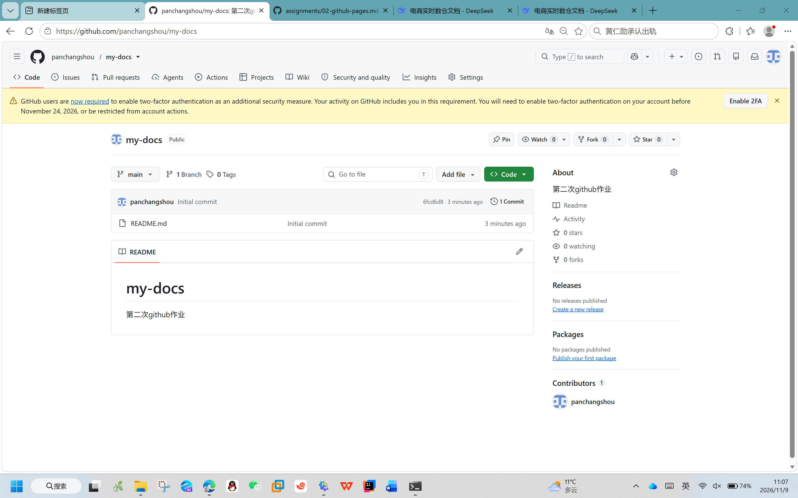
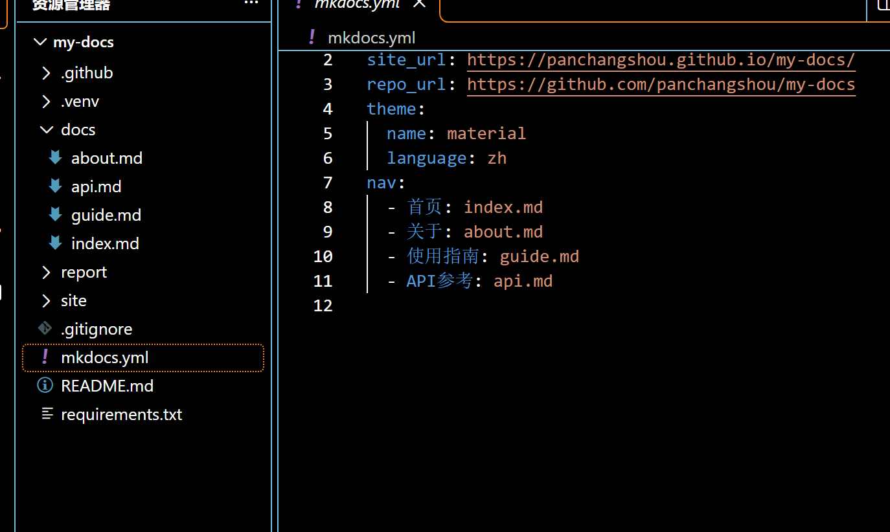
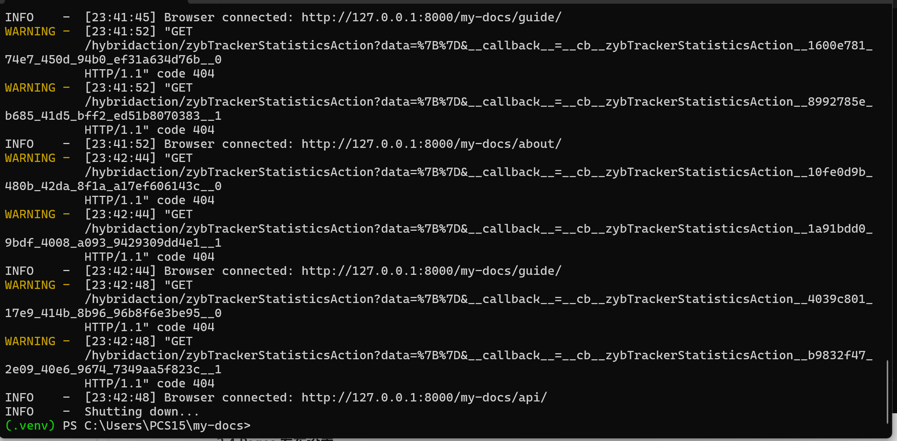
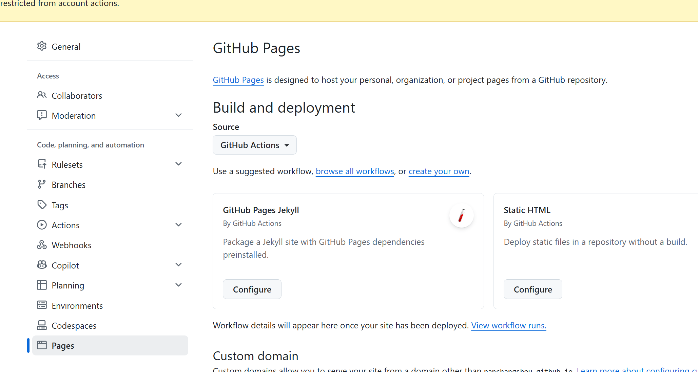
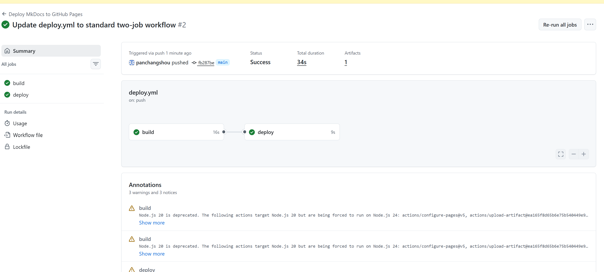
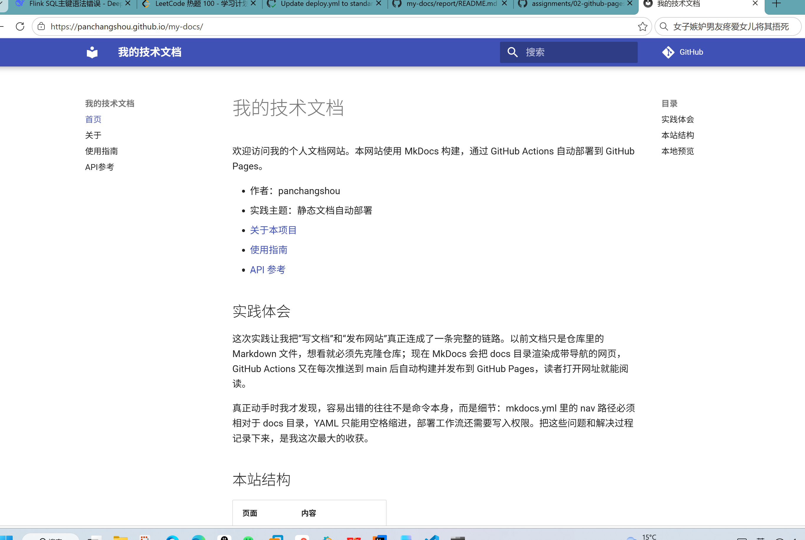
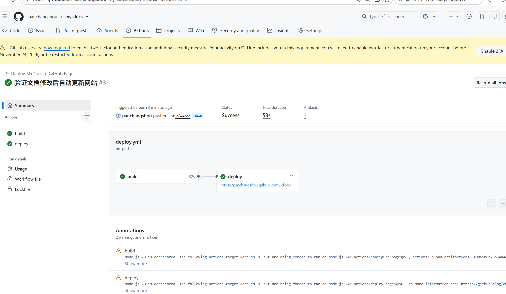
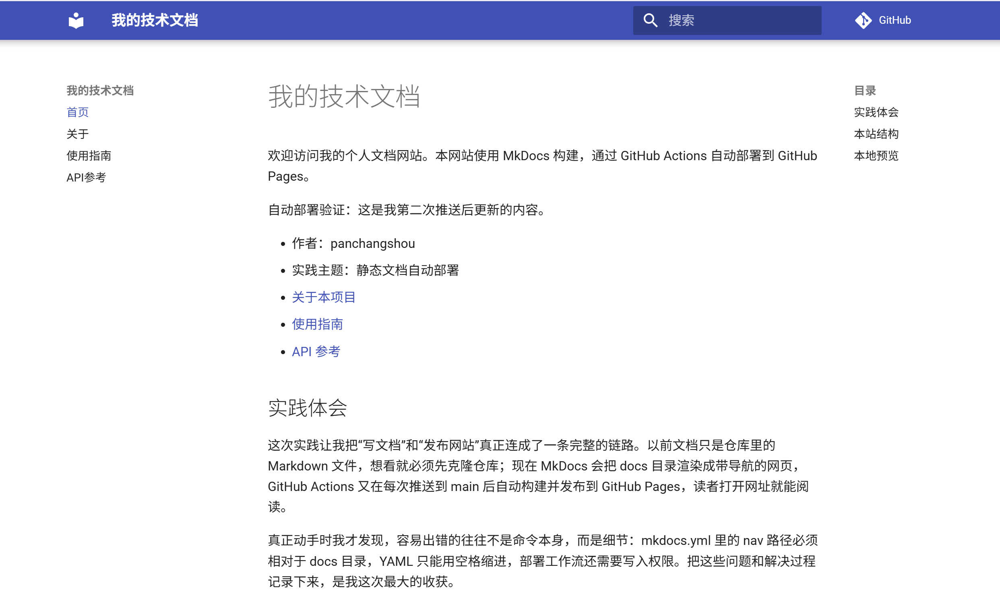

# 实践项目2：个人实验报告

## 1. 基本信息

- 姓名：潘长寿
- GitHub 登录名：`panchangshou`
- 个人仓库地址：<https://github.com/panchangshou/my-docs>
- 最终网站地址：<https://panchangshou.github.io/my-docs/>

## 2. 实践过程与关键截图

### 2.1 创建个人公开仓库

我在自己的 GitHub 账号下创建了 `my-docs` 仓库，并将可见性设为 Public。使用个人仓库可以让源码、提交记录、Actions 日志和 Pages 网站互相对应，也便于老师直接核验。

### 2.2 项目结构与 MkDocs 配置

网站正文放在 `docs/` 中，`mkdocs.yml` 负责站点名称、地址、主题和导航顺序。`nav` 中的路径相对于 `docs/`，所以写 `index.md`，而不是 `docs/index.md`。`site/` 是构建时生成的目录，已经加入 `.gitignore`，不会提交到 `main`。

### 2.3 本地构建与预览

我使用 Python 3.12 创建虚拟环境，安装 `requirements.txt` 中的依赖后执行 `python -m mkdocs build --strict`。构建通过后又检查了四页导航、表格、代码块和页面间链接。

### 2.4 Pages 发布设置

我在仓库 `Settings → Pages` 中把发布来源设为 GitHub Actions。这个项目使用官方 Pages 工作流直接上传和部署 `site/`，没有建立 `gh-pages` 分支，也没有填写个人访问令牌。

push：仅在 docs/、mkdocs.yml、requirements.txt 或工作流文件被推送到 main 分支时触发；单纯改报告或 README 不会引起构建。

workflow_dispatch：提供手动触发入口，可在 Actions 页面自行点击运行，用于初次部署、失败重跑或排查问题。

build：完成检出代码、安装 Python 3.12、装依赖、执行 mkdocs build --strict，最后把生成的 site/ 作为产物上传。

needs: build：让部署 job 依赖构建 job，只有构建通过后才会进入部署阶段，避免发布有问题的站点。

pages: write、id-token: write：这两项权限分别用于向 GitHub Pages 写入内容和获取 OIDC 令牌，是官方部署动作正常工作的必要条件。

github-pages：GitHub Pages 专用的部署环境，用来记录部署历史、展示当前线上地址，并回填页面 URL 方便追踪。

### 2.5 Actions 首次构建和部署

首次推送相关文件后，`Deploy MkDocs to GitHub Pages` 自动运行。`build` 任务负责取出源码、准备 Python、安装依赖、构建网站并上传产物；它成功以后，`deploy` 任务才会把产物发布到 Pages。

### 2.6 网站访问与四页导航检查

部署完成后，我通过公开地址访问网站，并依次打开首页、关于、使用指南和 API 参考。四页导航均可点击，表格和代码块显示正常，仓库链接也能返回源码页面。

### 2.7 第二次推送与自动更新验证

首次部署成功后，我在首页增加了一段“自动更新验证”文字，再单独提交并推送。此次没有手动运行工作流，Actions 页面显示 `Triggered via push`，说明是 `push` 事件自动触发了第二次构建和部署。网站刷新后也能看到新增段落。

- 对应提交链接：<https://github.com/panchangshou/my-docs/commit/3c0f57bcfdef30a369029c6883f84227189adb2d#diff-b4d68dc855d0f9476d3f2ee343853bd21bf82ea9960d0cf06661baa244439dd6>
- 对应 Actions 运行链接：<https://github.com/panchangshou/my-docs/actions/runs/43907224389>

## 3. 问题与解决

跨平台换行符警告（警告而非错误）：
在执行 git add 时，终端多次提示 warning: LF will be replaced by CRLF the next time Git touches it。经过查阅资料，这是因为 Windows 系统的换行符（CRLF）与 Linux/Mac（LF）不同。这属于 Git 的自动转换机制，完全不影响代码内容和后续的网页部署，因此直接忽略。

完成构建后，我还核对了以下配置：
mkdocs.yml 缩进正确，nav 中配置的四个文件均存在。
.gitignore 中正确排除了 .venv/ 和 site/，避免了无用文件被提交。
工作流监听的分支是 main，路径过滤配置无误。
仓库的 Settings → Actions → General 权限保持默认的只读，确保了安全。

## 4. 原理理解

### 4.1 `docs/` 和 `site/` 各保存什么？为什么不用手工修改 `site/`？

docs/ 保存我编写的 Markdown 源文件，是平时真正需要维护的核心内容。
site/ 保存 MkDocs 根据源码自动生成的 HTML、CSS 等静态文件。
原因：site/ 是由工具随时生成的结果。如果手工修改它，不仅会被下一次自动构建覆盖，还会导致源码与网页结果脱节，因此只需维护 docs/ 即可。

### 4.2 本次工作流在什么情况下自动运行？

向 main 分支推送代码，并且修改的文件包含 docs/**、mkdocs.yml、requirements.txt 或 .github/workflows/deploy.yml 时，工作流会自动触发。此外，配置中也保留了 workflow_dispatch，允许在 Actions 页面手动点击运行以进行排错和重试。

### 4.3 `build` 与 `deploy` 两个任务有什么区别？

build 任务：负责从源码得到可发布的网站产物。包括检出代码、准备 Python、安装依赖、严格构建（mkdocs build --strict）并上传 site/ 产物。
deploy 任务：不参与编译。它通过 needs: build 等待构建成功后，直接获取上传的产物并发布到 GitHub Pages。
区别：这种分离设计明确了“网站能否构建成功”和“产物能否部署成功”两个阶段，避免把有问题的构建结果发布出去。

### 4.4 只修改 `report/README.md` 会触发部署吗？为什么？

不会。 因为工作流的 paths 过滤列表中，没有包含 report/** 或 README.md。这是有意设置的，因为这些文件不属于 MkDocs 网站的内容，不需要为其重新构建和部署网页。

### 4.5 本次方案为什么无需创建 `gh-pages` 分支？

传统方案需要把打包好的网页推送到专门的 gh-pages 分支来展示。而本次方案采用了 GitHub 官方推荐的现代做法：通过 actions/upload-pages-artifact 将构建产物打包为临时 Artifact，再由 actions/deploy-pages 直接将这些 Artifact 部署到 Pages 服务中。发布对象不是代码分支，因此无需创建和维护 gh-pages 分支。
